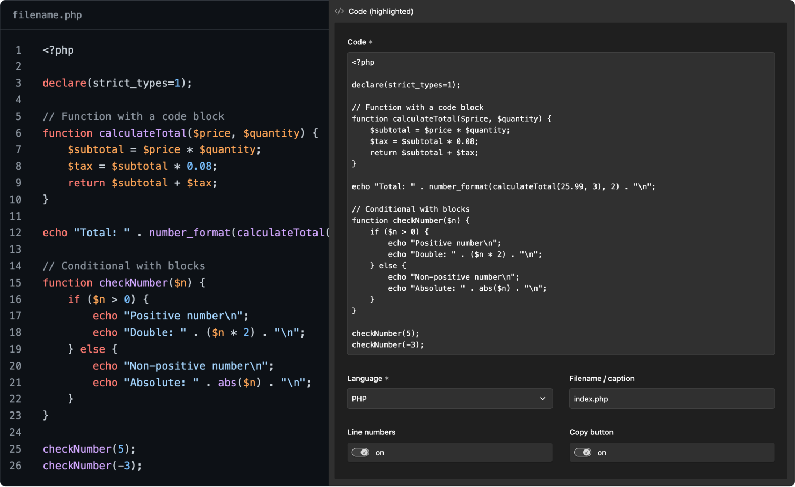

# Kirby Microlighter

A syntax-highlighted code block for Kirby's blocks field, powered by
[MicroLighter](https://daverupert.com/2026/08/microlighter/) by Dave Rupert.

Highlighting runs in the browser using the
[CSS Custom Highlight API](https://developer.mozilla.org/en-US/docs/Web/API/CSS_Custom_Highlight_API),
so the code stays plain text in your HTML: no `<span>` soup, no server-side
processing. The script (~9 KB) and stylesheets are only loaded on pages that
contain a code block, and language grammars are loaded on demand.

> **Beta.** This plugin has had limited testing. Please test it with your own
> setup before using it in production, and report issues.



## Features

- `microcode` block with code, language, filename/caption, line numbers and a copy button
- 40 languages, 12 colour themes (light and dark via `light-dark()`)
- Assets load once per page, and only when a code block is present

## Installation

```
composer require jamie-humm/kirby-microlighter:^1.0@beta
```

Or copy this folder to `site/plugins/kirby-microlighter`.

Requires Kirby 5 and PHP 8.2+.

## Usage

Add the block to a blocks field:

```yaml
fields:
  text:
    type: blocks
    fieldsets:
      - heading
      - text
      - microcode
```

The block renders through the plugin's `blocks/microcode` snippet. To change the
markup, copy `snippets/blocks/microcode.php` to `site/snippets/blocks/microcode.php`.
Keep the `Assets::once()` call so the script and stylesheets are still loaded.

## Options

```php
// site/config/config.php
return [
    'jamie-humm.kirby-microlighter' => [
        // github (default), vscode-plus, dracula, monokai, night-owl,
        // solarized-light, min, cobalt2, flexoki, gruvbox, tokyo-night, vesper
        'theme' => 'github',
        // auto (default) follows the visitor's light/dark preference,
        // light or dark forces one
        'mode' => 'auto',
        // false to skip the plugin's default block styles
        'css' => true,
    ],
];
```

An unknown theme name falls back to `github`, and an unknown mode to `auto`.

## Styling

The default stylesheet (`assets/microlighter.css`) frames the block with a
filename bar on top, using the theme's colours. Adjust it from your own CSS:

```css
.block-microcode {
  --microlighter-radius: 0;
  --microlighter-border: transparent;
  --microlighter-font: "JetBrains Mono", monospace;
}
```

The `<micro-lighter>` element renders its line numbers and copy button in a
shadow root. Style those with `::part()`:

```css
micro-lighter::part(copy-button) { border-radius: 2rem; }
micro-lighter::part(line-numbers) { opacity: 0.5; }
```

Theme colours are `--syntax-*` custom properties (see `dist/themes/*.css`) and
can be overridden on `.block-microcode`.

Themes follow the visitor's light/dark preference unless the `mode` option
forces one. To switch per page (for example, with your own dark mode toggle),
leave `mode` on `auto` and set `color-scheme: light` (or `dark`) on
`.block-microcode` from your CSS.

## Dynamic content

Once the script has loaded, any `<micro-lighter>` element added to the page
later is highlighted automatically.

## Browser support

Needs the CSS Custom Highlight API (Chrome/Edge 105+, Safari 17.2+,
Firefox 140+). In older browsers the code is shown as plain, unhighlighted text.

The copy button uses the Clipboard API, which only works on HTTPS (and `localhost`).

## Notes

- The bundled files are served from `/microlighter-assets/…` by a plugin route,
  because the script loads its grammars by relative path. Avoid a page with
  that slug.

## Credits

This plugin bundles [MicroLighter](TODO-link-to-microlighter) © 2026 Dave Rupert,
MIT licensed (see `dist/LICENSE-microlighter.txt`). It is an unofficial Kirby
integration and is not affiliated with the MicroLighter project.

## License

MIT © Jamie Hunter
